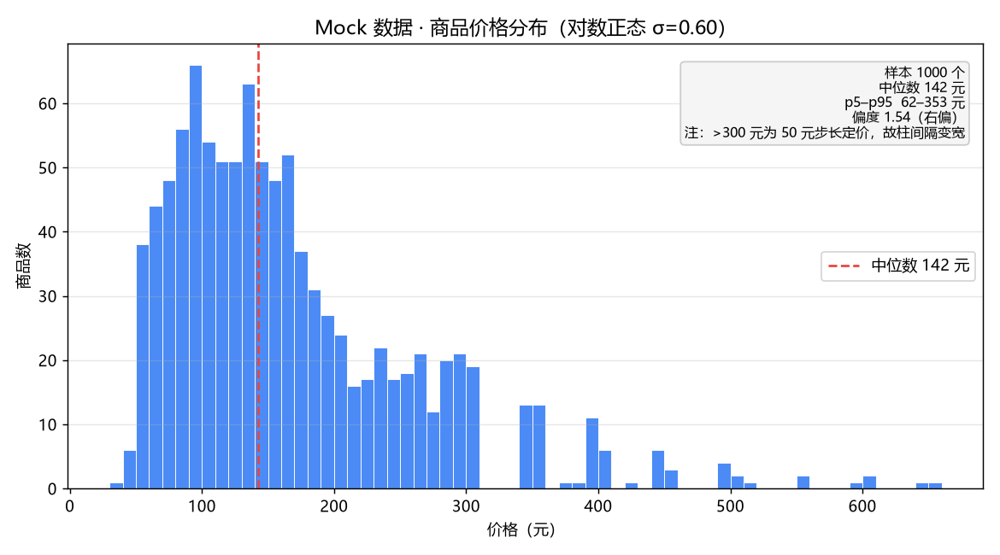
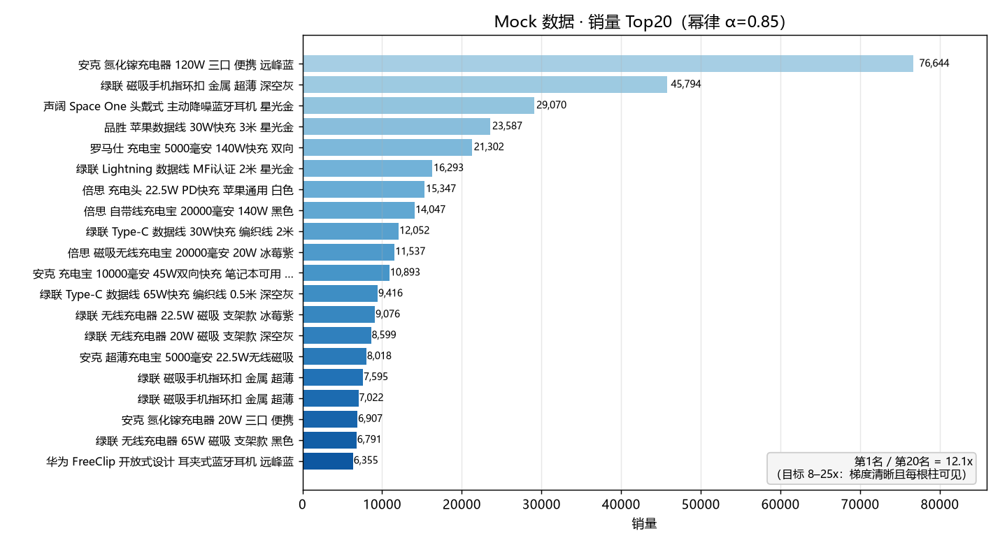
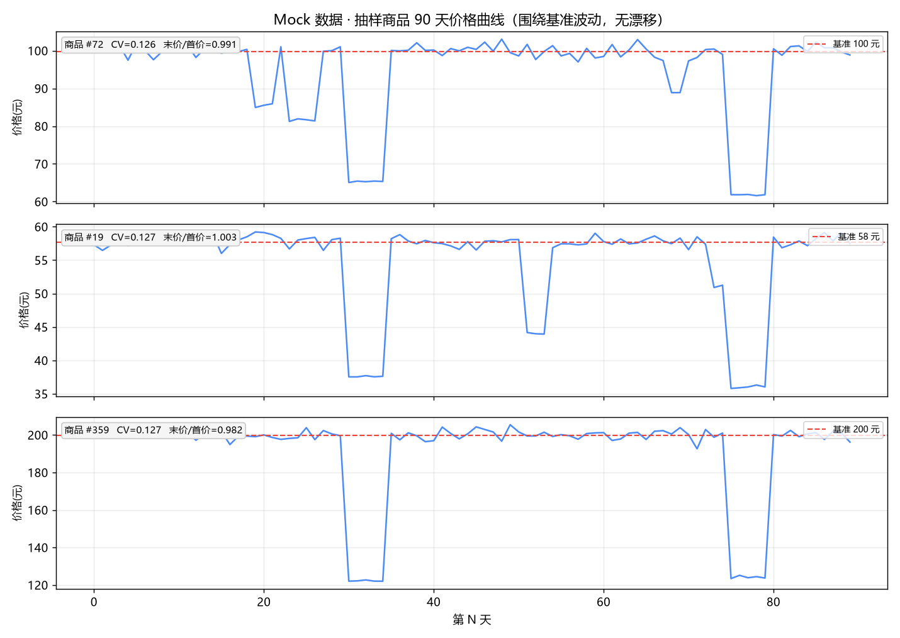

# 电商竞品情报分析平台

> 采集 → 清洗 → 存储 → 可视化 → AI 分析 → 导出/告警，一条跑得通的完整数据管道。
>
> 这是一个求职作品集项目。它想证明的不只是"这条链路能跑"，
> 还有**每一个取舍背后的实测数据**——包括那些没能验证成功的部分。

---

## 一分钟版

|  |  |
|---|---|
| **数据** | SQLite（WAL），7 张表。当前库里 **1100 个商品**（Mock 1000 + 真实采集 100）、**90098 条价格点**、17 个店铺 |
| **接口** | FastAPI，**22 个端点**；4 个静态页面（ECharts 5.6.0，零构建、无 Node） |
| **测试** | pytest **766 条 / 21 个文件**，全绿。不联网、不碰真实库 |
| **文档** | [`docs/可行性评估.md`](docs/可行性评估.md)，**2405 行**，逐阶段记录实测发现 |
| **运行** | Python 3.13.7 + venv，端口 **8001** |

## 快速开始

```bash
python -m venv .venv && source .venv/Scripts/activate     # Windows: .venv/Scripts/activate
pip install -r requirements.txt

python -m scraper.seed --count 1000     # 生成 Mock 数据（幂等，可反复跑）
uvicorn app.main:app --port 8001        # 打开 http://localhost:8001
```

AI 分析需要一个智谱 GLM key（`cp .env.example .env` 后填入）：

```bash
curl -X POST http://localhost:8001/api/analysis/run     # 第一次调模型
curl -X POST http://localhost:8001/api/analysis/run     # 第二次应 from_cache: true
```

用的是 `glm-4-flash`——长期免费且不限量，整个项目跑下来 API 成本为零。
**没有 key 时该接口返回 503 并说明原因，其余功能完全不受影响**（不会静默降级成假报告）。

真实数据那条路径是**离线重放**，不联网、不消耗任何额度。它把 5 个真实抓取页
灌进库里然后**退出**（是"灌一次"，不是常驻）：

```bash
python -m scraper.worker --replay       # 灌入 100 条真实数据，跑完即退出
python -m scraper.worker                # 常驻：认领页面上的采集任务 + 每 5 分钟检查告警
```

★ 默认参数的 worker **拒绝联网**：页面上入队的 `smzdm` 任务会明确失败，并告诉你
"未联网（不是被拦截）"以及怎么打开——这不是报错，是刻意的开关。
只有 `mock` 源离线可用。要真联网得显式加 `--allow-network`，请先读下面的合规那节。

## 架构

```
                   浏览器（4 个静态页 + ECharts，零构建）
                             │  fetch /api/*
                             ▼
        ┌──────────── FastAPI（app/）────────────┐
        │  22 个端点：统计 / 商品 / 任务 / 分析    │
        │  ★ 这里没有一行采集代码                │
        └───────┬────────────────────┬───────────┘
                │ SQLite (WAL)       │ 只写一行 crawl_tasks(status=pending)
                ▼                    ▼
        data/ecom.db  ◀──── worker（scraper/，**独立进程**）
                ▲              ├─ 认领任务：一条 SQL 完成"选中 + 占住"
                │              ├─ 采集：JSON → HTML → Playwright（分层降级）
                │              ├─ 清洗 → 归并 → UPSERT
                │              └─ 每 5 分钟扫一遍告警规则（armed/fired 状态机）
                └── GLM 分析（数据指纹做缓存键）／导出 CSV·Excel／图片代理
```

把采集拆成独立进程不是"为了解耦而解耦"，三条理由都是实测出来的：

1. **Playwright 绝不能在 API 进程里跑。** Windows 上 uvicorn 的 reload 模式内部用
   `use_subprocess=True`，worker 事件循环会落到 `SelectorEventLoop`，而它**不支持子进程**——
   Playwright 启动 Chromium 必崩（`NotImplementedError`）。采集独立进程用默认的
   `ProactorEventLoop`，天然绕开。
2. 长任务不能绑在请求上：采集要几秒到几分钟，请求早返回了。
3. 采集是 CPU + 网络密集且突发，Web 是 IO 密集且要低延迟，放一个进程里会让页面卡住。

代价也说清楚：**API 和 worker 是两件独立的事，要分别启动**。只起 Web 服务时，
任务会永远停在 `pending`——所以入队响应里直接带了 worker 的启动命令，而不是让人对着进度条猜。

## 七个值得一看的实现

| 实现 | 一句话 | 位置 |
|---|---|---|
| **爆料归并为价格事件** | 抓到的不是"商品"而是"价格事件"：同一商品被反复爆料 → 自然形成价格时间序列。硬门槛（品牌 + 规格 token 一票否决）先挡一遍，再用 Dice ≥ 0.75 归并；**阈值在 277 条真实标题上标定**，不是拍脑袋 | [`scraper/dedup.py`](scraper/dedup.py)、[docs §12.4](docs/可行性评估.md) |
| **分层降级采集** | JSON 接口 → 服务端渲染 HTML → Playwright，写成显式结构；拦截判定不靠"有没有某个 JS"，因为正常页面也带它 | [`scraper/base.py`](scraper/base.py)、[docs §16.3](docs/可行性评估.md) |
| **双数据源隔离** | `source` 字段把"数据血缘"和"销售平台"拆成两个维度，所有统计接口支持 `?source=mock\|smzdm\|all`。Mock 用于联调演示，真实数据用于验证管道 | [`app/aggregate.py`](app/aggregate.py) |
| **任务队列而非 `BackgroundTasks`** | 任务状态在数据库里而不是进程内存里，所以刷新页面能恢复进度；同一个源已有待办任务时**不再入队第二个**（并发下也成立——判断写在 INSERT 的 `WHERE` 里，实测 4 并发 → 1 个任务） | [`app/api/tasks.py`](app/api/tasks.py) |
| **AI 缓存按数据指纹** | 指纹含 prompt 版本 + 模型名 + 模型实际看到的每一个字段，**排除**自增 id 与采集时间戳；留了 `?force=1` 的 bypass 出口，避免演示时"我再生成一次"却秒回旧报告 | [`app/analysis/fingerprint.py`](app/analysis/fingerprint.py) |
| **告警状态机** | `armed` / `fired` 两态避免"价格持续低于阈值期间一天写 288 条记录"；改规则 = 重新武装，但**不补发通知** | [`scraper/check_alerts.py`](scraper/check_alerts.py) |
| **图片代理的 SSRF 防护** | 域名白名单 + 禁止 IP 直连（含十进制/八进制变体）+ 解析后再校验真实地址；顺带处理了同源 XSS（代理本身会把三方图变成同源内容） | [`app/api/images.py`](app/api/images.py)、[docs 第十八节](docs/可行性评估.md) |

## 真实数据与合规

这一节是刻意写在显眼位置的——采集类项目最容易在这里含糊过去。

- **遵守 robots.txt，请求间隔 2–3 秒，不采集任何个人信息，仅用于学习与研究。**
- **SMZDM 有 WAF。** 实测约 50~100 次请求后开始返回验证码挑战页（HTTP 200），随后 403。
  发现后**主动停手**：不破解验证码——那既越界也没必要。
- **所以真实采集走"离线重放"**：5 个真实抓取页 + 1 个 185 字节的 WAF 拦截图（共 1.8 MB）
  已提交进 [`tests/fixtures/`](tests/fixtures/)，解析器、拦截判据、归并逻辑全部可以离线验证。
  重放用的是真实 HTML，不是造的。这一点在 WAF 封禁之后尤其重要——
  重新抓的代价不是流量，是额度。
- **不做假数据。** Mock 与真实数据严格分源（`?source=` 可切换对比），
  从没有为了演示效果手工塞过一行 `source='smzdm'`，也没有塞过一份假的模型报告。

三张 Mock 数据的自检图（生成脚本在 [`spike/plot_seed.py`](spike/plot_seed.py)）：





价格用**对数正态 σ=0.60** 采样后做心理定价吸附（`149.9` 而不是 `187.34`）；
销量用**幂律 α=0.85**，让 Top20 每一根柱子都看得见；
价格序列**围绕固定基准波动、绝不逐日累乘**——累乘会产生对数漂移，
实测 90 天后价格跌到初始值的 12%，折线图会变成一条滑梯。

## 测试

```bash
pytest -q          # 766 passed
```

重点覆盖：脏数据解析（`"已售1万+"` 这类边界，清洗函数承诺**对任何输入都不抛异常**）、
归并的硬/软门槛、`ON CONFLICT DO NOTHING` 真的生效、指纹缓存（同输入同 hash、打乱顺序不变、
改 prompt 版本必变）、告警状态机三态、SSRF 白名单的各种绕过写法、
WAF 拦截页与正常页的区分、以及**并发竞态**（用真实文件库 + Barrier 才能复现，
测试夹具的内存库会把操作串行化、100% 复现不出来）。

两条自我约束：**测试不碰 `data/ecom.db`**（用内存库或临时文件库），
**测试不向 zdimg / smzdm 发真实请求**（用已提交的 HTML 夹具）。

## 已知边界（如实记录）

| 边界 | 状态 |
|---|---|
| **浏览器端未做人眼确认** | 前端与图表**没有经过人眼确认**（开发环境无浏览器），只做了脚本级断言。这是最大的裸区 |
| **AI 分析报告** | 代码与测试都在，但**从未用真实 key 跑过一次**——本仓库不含任何模型输出。补齐方法见 [docs §15.7](docs/可行性评估.md) |
| **worker 崩溃后任务卡在 `running`** | 自愈代码和两条测试都在（阶段 4 写的），但代码 review 那一轮**没有回去跑一遍复现**，所以按"未复核"记 |
| **多进程部署** | 并发修复依赖"单条 SQL 是原子的"，单进程多线程下已实测；`uvicorn --workers N` 下同理，但**未实测** |
| **定时采集（APScheduler）** | 未做。worker 的轮询循环已经覆盖了"定时采集"的语义，APScheduler 的增量价值主要是持久化 job store 与多实例抢占，对单机项目边际收益低 |
| **`busy_timeout` 到期路径** | 配置是 30 秒，这条路径**没有构造过** |

## 目录结构

```
ecom-intel/
├── app/            FastAPI：22 个端点、数据聚合、GLM 分析、指纹、图片代理
├── scraper/        采集层（独立进程）：清洗、归并、数据源、worker、种子数据
├── frontend/       4 个静态页面 + ECharts 本地兜底（CDN 挂了也能画）
├── tests/          766 条测试 + 真实抓取页夹具
├── spike/          开工前的可行性验证与阈值标定脚本（可离线复现全部标定结论）
├── docs/           设计文档 + Mock 自检图
└── data/           SQLite 库与图片缓存（不入库，seed 可重建）
```

## 文档地图

[`docs/可行性评估.md`](docs/可行性评估.md) 是这个项目真正的核心产物，2405 行，分阶段记录：

| 章节 | 内容 |
|---|---|
| §一 – §十一 | 开工前的方案评估：为什么砍掉 1688 / 为什么 `BackgroundTasks` 不行 / 数据源怎么选 |
| §十二 | **真实数据标定实录**：WAF 升级与主动停手、归并阈值被数据推翻、Dice 阈值的标定过程 |
| §十三 | Mock 数据生成的三个发现（累乘漂移、大促日被普通促销吃掉、图会骗人） |
| §十四 | API 层的四个实测发现（空态契约、差一错误、一次证伪） |
| §十五 | AI 分析层（同一套 key 规则写了三遍且两份已分叉、一次假绿、数据本身的 bug） |
| §十六 | 真实采集（降级链第一层从没被证实存在过、`probev3.js` 是假信号、seed 标题 42% 重名藏了三个阶段） |
| §十七 | 告警链路（98% 的商品让跌幅规则永远静默——这推出了一个接口行为） |
| §十八 | 图片代理（白名单挡的是"名字"，真正被连接的是"地址"；诚实的残余风险） |
| **§十九** | **代码 review 全程记录**：18 条可疑点 → 按形状分组 → 三条反直觉（三处竞态里有一处是误报，而它正是另外两处的样板） |

## 技术栈

| 层 | 选型 | 一句话理由 |
|---|---|---|
| Web | FastAPI 0.141 + uvicorn | 同步端点跑在线程池里，阻塞的 DNS / httpx 调用不会卡住事件循环 |
| 存储 | SQLite + WAL | 单机零运维；WAL 让读写互不阻塞，`busy_timeout=30s` 等锁 |
| ORM | SQLAlchemy 2.0 | 停在 2.0：2.1 已发布，但生态与资料全是 2.0 写法 |
| 清洗 | 纯 Python（`re` + `dataclass`） | 逐条字符串解析用不上向量化，却要背 30MB 依赖和一套 dtype 语义 |
| 前端 | 原生 HTML + ECharts 5.6.0 | 零构建配置，面试现场断网有本地兜底 |
| AI | 智谱 GLM（OpenAI 兼容层） | 同一套代码可切 Ollama / SiliconFlow，只改三个环境变量 |
| 测试 | pytest | 766 条 |

---

**一句话总结**：这个项目里唯一比"代码能跑"更重要的，
是**每个判断都能追溯到一次实测**——包括那些实测推翻了原计划的部分。
